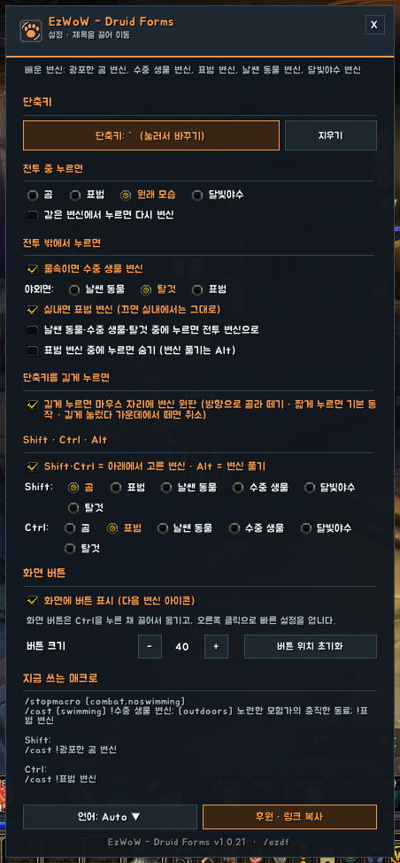
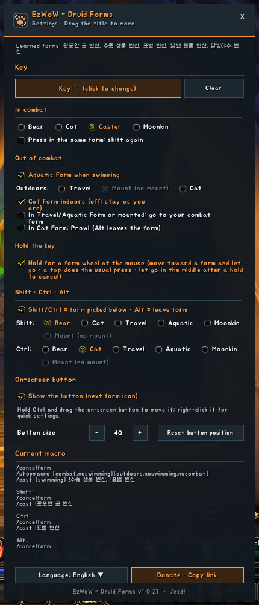

# EzWoW - Druid Forms

단축키 하나로 상황에 맞는 드루이드 변신을 합니다.
One key for the right druid form.

- 명령어 / Commands: `/ezdf`, `/드루이드`

## 한국어

> 실제 게임 화면입니다(WoW Forever, 한국어 클라이언트). 캐릭터 · 다른 플레이어 이름과 채팅 내용은 가렸습니다.

| 상황 | 누르면 |
|---|---|
| 물속 (전투 중에도) | 수중 생물 변신 ("물속이면 수중 생물 변신"을 켰을 때). 이미 수중 생물이면 그대로 |
| 전투 중 | 고른 변신(곰 / 표범 / 원래 모습 / 달빛야수). 이미 그 변신이면 그대로("같은 변신에서 누르면 다시 변신"을 켜면 풀었다가 다시 변신). 다른 변신 중이어도 한 번에 바뀜 |
| 전투 밖 · 야외 | 고른 것: 날쌘 동물 / 탈것 / 표범 (없으면 다음 것). 탈것을 골라도 움직이는 중이거나 탈것을 못 타는 곳이면 날쌘 동물(없으면 표범) |
| 전투 밖 · 실내 | 표범 변신 (끌 수 있음) |
| 전투 밖 · 이미 그 변신 | 원래 모습 |
| 전투 밖 · 날쌘 동물·수중 생물·탈것 중 | "전투 변신으로"를 켜면 전투 중 변신으로 바로 바뀜 (전투 준비). 끄면 탈것에서 내리기만 함 |
| 전투 밖 · 표범 변신 중 | "숨기"를 켜면 숨기 (이미 숨어 있으면 그대로) |
| Shift / Ctrl (언제나) | 각각 고른 변신 또는 탈것 (기본: 곰 / 표범). 이미 그 변신이면 그대로 |
| Alt (언제나) | 변신 풀기 / 탈것에서 내리기 |
| 길게 누르기 | 마우스 자리에 변신 원판이 나옵니다. 고를 변신 쪽으로 마우스를 옮겨 떼면 그 변신(전투 중에도), 짧게 누르면 위의 기본 동작, 길게 눌렀다가 가운데에서 떼면 취소(전투 중에는 마우스가 가운데를 벗어났다 돌아온 경우) ("단축키를 길게 누르면"에서 끌 수 있음) |

- **설정 고르기**: 켜고 끄는 항목은 체크박스, 여러 개 중 하나를 고르는 항목(전투 중 변신, 야외 변신, Shift·Ctrl 변신)은 라디오 버튼입니다. 빠른 설정과 설정 창에 같은 목록이 있습니다.
- **단축키**: 설정 창(`/ezdf`)에서 버튼을 누르고 쓸 키를 누르거나(Esc 취소, 마우스 휠·가운데·옆 버튼도 가능), 게임 단축키 설정의 "애드온" 항목에서 지정합니다. 그 키의 기존 동작이 바뀌거나, Shift/Ctrl + 그 키가 이미 다른 기능에 쓰이고 있으면 대화창에 알려 줍니다(그 조합으로는 Shift/Ctrl 변신이 동작하지 않습니다). 게임 설정의 "키를 누를 때 시전" 여부(누를 때 / 뗄 때)를 그대로 따릅니다. 단, 변신 원판을 켜 두면 짧게 누를 때도 키를 뗄 때 동작합니다.
- **화면 버튼**: 왼쪽 클릭으로 변신하고, 아이콘은 지금 누르면 될 변신을 보여 줍니다. 오른쪽 위는 단축키, 왼쪽 아래는 전투 중 변신입니다. 마우스를 올리면 단축키·전투 중 변신·물속/야외/실내 변신을 툴팁으로 보여 줍니다.
- **빠른 설정**: 화면 버튼을 오른쪽 클릭하면 위 설정을 바로 바꾸고, 단축키 지정이나 설정 창 열기로 갈 수 있습니다. 아직 쓸 수 없는 것은 회색이고, 옆에 배우는 레벨(또는 특성, 탈것 없음)이 나옵니다. 전투 중에 바꾸면 전투가 끝난 뒤 적용됩니다.
- **탈것**: 탈것 도감의 즐겨찾기를 먼저, 없으면 처음 모은 탈것을 씁니다. 탈것은 시전 시간이 있어 움직이는 중에는 탈 수 없습니다.
- **이동**: Ctrl을 누른 채 화면 버튼을 끌어서 옮깁니다. 설정 창에서 숨기기·크기(24~64)·위치 초기화를 할 수 있습니다.
- 변신 막대에 있는 **배운 변신만** 쓰므로 레벨에 따라 자동으로 맞춰집니다. 지금 모습(변신 없음·탈것·각 변신)마다 매크로를 따로 만들어 두고, 장소·전투 판단은 게임 매크로 조건으로 하므로 전투 중에도 동작합니다. 설정 창에서 지금 쓰는 매크로를 볼 수 있습니다.
- 드루이드가 아닌 캐릭터에서는 아무것도 하지 않습니다. 언어는 자동 + 8개 언어 중에서 고릅니다.

<!-- ezwow-pad-share -->
### 게임패드
- 게임패드 UI를 켜면 EzWoW 창을 패드로 다룰 수 있습니다. 방향키로 이동, A(✕)로 누르기, X(□)로 오른쪽 클릭, LB/RB로 스크롤, B(○)로 닫기입니다. 창 아래에 연결된 패드 모양으로 키 안내가 나옵니다.
- 블리자드 창이 열려 있지 않을 때 **보기(Back) / Create 버튼**을 누르면 화면의 EzWoW 프레임(유틸리티 바, 퀘스트 목록 등)으로 이동합니다. 다시 누르거나 B를 누르면 돌아갑니다.
- 다른 버튼을 쓰려면 설정 > 단축키 > 애드온 > EzWoW > "게임패드: EzWoW 창으로 이동/돌아가기"에 지정합니다(EzWoW-MapFinder가 설치돼 있을 때).

### 기록 공유
- 모든 EzWoW 애드온이 함께 쓰는 기록 공유가 **기본으로 켜져 있습니다**. 직접 확인한 퀘스트 NPC, 희귀 몬스터 목격, 아이템 드롭, 채집 위치를 다른 EzWoW 사용자와 나눕니다.
- `/ezshare` 또는 `/공유`: `on` / `off` 켜기·끄기, `channel on` / `channel off` 서버 채널 사용, `status` 현재 상태와 기록 수.
- 같은 기록을 되풀이해 보내지 않고, 상대에게 없는 기록만 주고받습니다. `/ezshare` 창의 사람 탭에서 상대가 쓰는 공유 버전과 EzWoW 애드온 버전을 볼 수 있습니다.

## English

> In-game screenshots with the addon set to English. The game client is Korean, so game text such as zone, item and spell names stays Korean. Character and player names and chat text are blurred.

| Situation | Press |
|---|---|
| Swimming (also in combat) | Aquatic Form (when "Aquatic Form when swimming" is on); already aquatic: it stays |
| In combat | Your choice (Bear / Cat / Caster / Moonkin); already in it: it stays (with "shift again" on, you leave and shift again); from another form it changes in one press |
| Out of combat · outdoors | Your choice: Travel Form / mount / Cat (the next one if you do not have it). With the mount chosen, while moving or where mounts aren't allowed: Travel Form (else Cat) |
| Out of combat · indoors | Cat Form (optional) |
| Out of combat · already in that form | Caster form |
| Out of combat · in Travel/Aquatic Form or mounted | With "go to your combat form" on: your combat form in one press (combat ready). Off: mounted, you just get off |
| Out of combat · in Cat Form | With "Prowl" on: Prowl (already prowling: nothing) |
| Shift / Ctrl, any time | The form or mount you pick for each (default: Bear / Cat); already in it: it stays |
| Alt, any time | Leave the form / get off the mount |
| Hold the key | A form wheel opens at the mouse. Move toward a form and let go to take it (also in combat); a tap does the usual press above, and letting go in the middle after a hold cancels (in combat: after the mouse left the middle and came back) (can be turned off under "Hold the key") |

- **Choosing**: on/off settings are check boxes; settings where you pick one (combat form, outdoors, Shift and Ctrl) are radio buttons. The quick menu and the settings window show the same list.
- **Key**: in settings (`/ezdf`) click the key button and press a key (Esc cancels; mouse wheel, middle and side buttons work too), or use the game's Key Bindings ("AddOns"). Chat tells you when the key's old action is replaced, or when Shift/Ctrl + that key is already bound elsewhere (those combinations then won't use the Shift/Ctrl form). The game's "cast on key down" setting is followed; with the form wheel on, a tap acts when you let go of the key.
- **On-screen button**: left-click to shift; the icon shows what the next press does. Top right: the key. Bottom left: the combat form. Hover for a tooltip with the key, the combat form and the water / outdoors / indoors forms.
- **Quick menu**: right-click the button to change the settings above, or jump to setting the key or opening settings. What you cannot use yet is grey, with the level (or talent, or "no mount") next to it. Changes made in combat apply when it ends.
- **Mount**: a favorite from your mount collection first, otherwise the first one you collected. Mounting has a cast time, so it fails while you move.
- **Move**: hold Ctrl and drag the button. Hide it, resize it (24–64) or reset its position in settings.
- Only forms on your stance bar are used, so it follows your level. A macro is made for each thing you can be (caster, mounted, each form), and the game's macro conditions judge the place and combat, so it works in combat; settings show the current macro.
- Does nothing on characters that are not druids. Language: automatic or one of 8 languages.

### Gamepad
- With the gamepad UI on, EzWoW windows work with a gamepad: D-pad to move, A (✕) to press, X (□) for right-click, LB/RB to scroll, B (○) to close. A key guide in your pad's button style shows under the window.
- With no game window open, press **View (Back) / Create** to move to the EzWoW frames on screen (Utility Bar, quest list and more). Press it again or B to go back.
- To use another button, set Key Bindings > AddOns > EzWoW > "Gamepad: move to / leave the EzWoW frames" (with EzWoW-MapFinder installed).

### Record sharing
- Record sharing, used by all EzWoW addons, is **on by default**. Quest NPCs, rare monster sightings, item drops and gathering spots you have seen yourself are shared with other EzWoW users.
- `/ezshare`: `on` / `off` to turn it on or off, `channel on` / `channel off` for the server channel, `status` for the current state and record counts.
- Records are not sent again and again: players exchange only what the other side does not have yet. The Players tab of the `/ezshare` window shows each player's sharing version and EzWoW addon versions.

---

## Support / 후원

If you find this addon useful, you can support its development.

애드온이 도움이 되셨다면 개발 후원으로 응원해 주세요.

[Buy Me a Coffee ☕](https://buymeacoffee.com/qqhrqqhr2)

